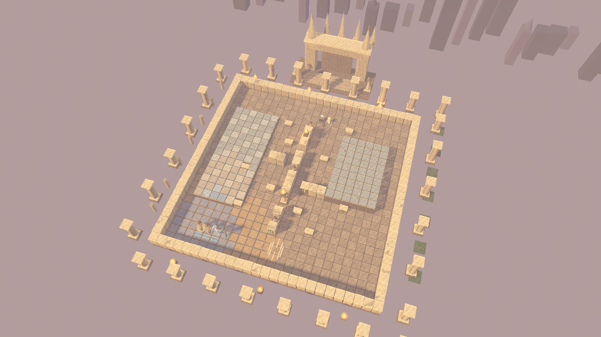
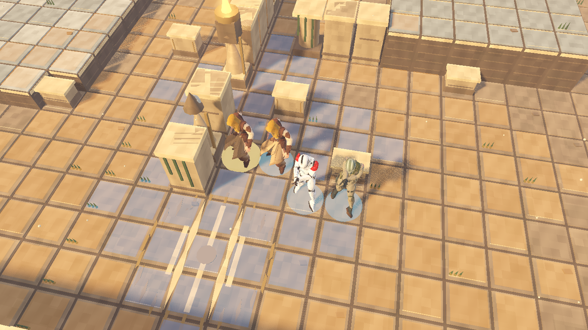
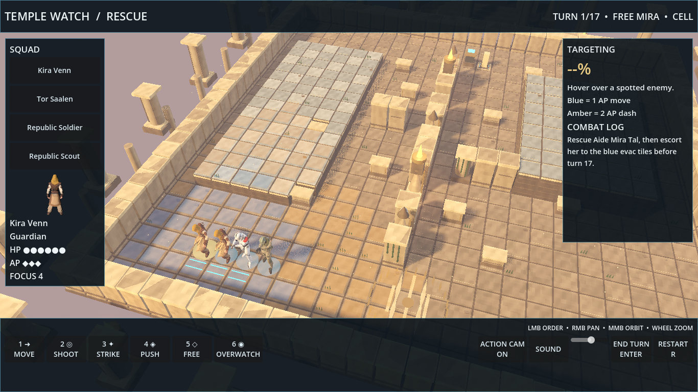
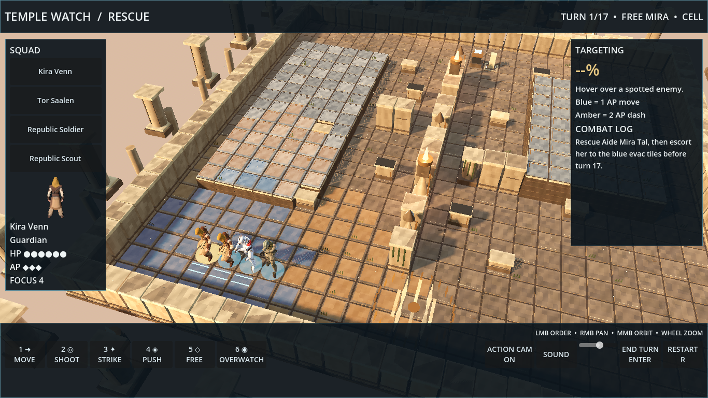
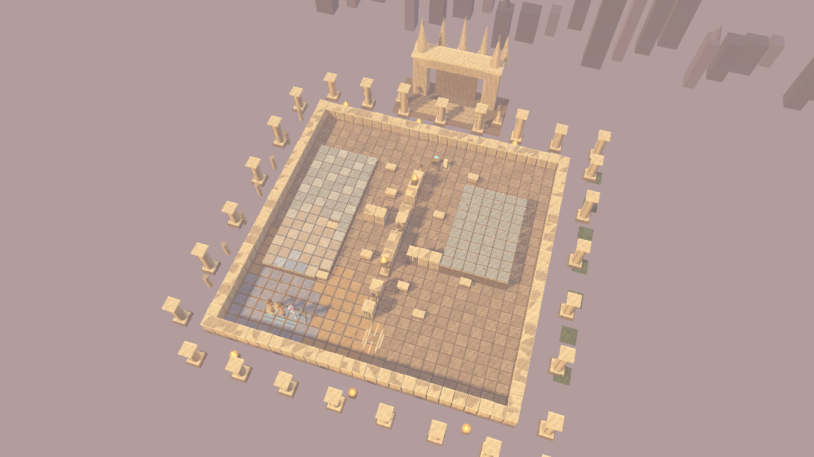
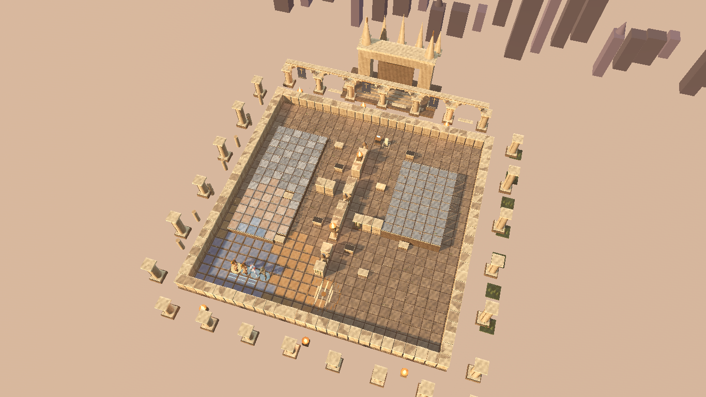

# Jedi Temple environment art

The rescue board is drawn by `godot/scripts/env_art.gd` from the live `rescue.json` mission grid. The rules remain in `mission.gd` and `shot.gd`. A tile's visible form follows its rule glyph:

| Glyph | Art |
| --- | --- |
| `.` | Worn stone flagstones, grout, occasional chips and small growth |
| `^` | Raised pale stone terrace at 0.7 m |
| `M` | Raised marble terrace at 1.4 m with carved risers |
| `#` | Full-height carved wall, broken column, or guardian statue |
| `c`, `h` | Waist-high stone cover and reinforced barricade |
| `k` | Waist-high holo-terminal |
| `r` | Loose rubble after cover breaks |
| `E` | Cyan evacuation inlay |

The mission is surrounded by ruined columns, planters, braziers, a temple gate with spires, and a distant Coruscant silhouette. A sun crest is inlaid in the open lower courtyard. Stone color, grain, edge wear, and moss are procedural in `godot/assets/env/stone.gdshader`; no external textures or models were added. Golden-hour sun, cool fill, depth fog, and brazier lights are configured by `env_art.gd` when the board is created. Braziers flicker in `_process`.

Repeated floor, trim, wall, vegetation, and skyline pieces are grouped into `MultiMeshInstance3D` batches. Only substantial structures cast shadows; flagstones and small details do not, which keeps software capture and shadow rendering practical. The Force Push code already calls `_build_terrain()` when a cover tile changes. That call now rebuilds art from the current mission grid, so a broken wall or barricade becomes rubble while the existing chunk effect plays.

## Tuning

- Adjust palette and procedural surface parameters in `_setup_resources()` and `stone.gdshader`.
- Adjust cover heights in `_wall()`, `_low_wall()`, and `_terminal()` while keeping `#` visibly taller than `c`, `h`, and `k`.
- Adjust non-playable scenery in `_backdrop()` and `_temple_gate()`; these are outside the 26 × 26 rule grid.
- Adjust sun, fill, fog, and sky in `_configure_lighting()`. Brazier range and energy live in `_brazier()`.
- The game uses the mission's live glyphs, so new rubble from Force Push requires no art data edit.

## Verification and captures

Actual `./godot/test.sh` result on Godot 4.7.2: **140 checks, 0 failures; Normal rescue bot 11/20 wins (55%)**. The test count includes concurrent AI and difficulty work. Both PNGs were captured with Forward+ software Vulkan under `xvfb-run`; RTX frame rate was not measured. The closeup uses a posed squad beside the mission's real cover, with the HUD hidden for the art still.

```bash
xvfb-run -a -s '-screen 0 1366x768x24' /home/jess/projects/.tools/godot/godot --path godot --resolution 1366x768 -s res://scripts/env_capture.gd -- overview
xvfb-run -a -s '-screen 0 1366x768x24' /home/jess/projects/.tools/godot/godot --path godot --resolution 1366x768 -s res://scripts/env_capture.gd -- closeup
```





## Wave 4 art report

### Player view

The temple now has a north arcade with open arches, sunlit windows, blue and gold banners, and a stronger visual path to the gate. Elevated terraces have pale marble, bronze or dark inlay, and carved risers that separate them from the lower courtyard. Stone has procedural color, normal, roughness, and edge variation. Reinforced half cover has a dark metal cap, while full cover remains tall stone. The scene uses warm directional light, cool fill, soft volumetric fog, ACES tonemapping, restrained glow, and contact shading. All added architecture stays outside the playable grid; cover heights and tile highlights remain legible from the default camera.

To see it in game, start the rescue mission from the menu. The default camera shows the terraces, cover, and inlay; zoom toward the north gate to see the arcade and banners.

### Same-camera captures

Both pairs were captured at 1366 × 768 with the same mission seed and camera coordinates. The default pair includes the HUD and units. The overview pair shows the entire board.

| Camera | Before | After |
| --- | --- | --- |
| Default |  |  |
| Overview |  |  |

### Verification and timing

`./godot/test.sh`: **140 checks, 0 failures**; Normal rescue bot 11/20 wins (55%). No rule code changed.

The `env_capture.gd` benchmark warms up for 60 frames and measures 180 presented frames at 1366 × 768, Forward+ Vulkan on the NVIDIA GeForce RTX 4090 Laptop GPU. Under Xvfb, the overview camera measured **29.25 ms mean / 25.83 ms median / 50.00 ms p95 before**, and **28.30 ms mean / 25.94 ms median / 46.08 ms p95 after**. Xvfb reports no DRI3 presentation support and runs at roughly 34–35 fps. A direct Wayland run of the final scene measured **7.01 ms mean / 6.12 ms median / 10.94 ms p95**, or 142.7 fps mean. A repeat direct run measured 3.53 ms mean / 4.34 ms p95. Both direct runs meet the 60 fps frame budget of 16.67 ms.

### Integration requests

- No `game.gd` hook is needed. The existing `_build_terrain()` call invokes `env_art.gd` and rebuilding cover still uses live mission glyphs.
- The Wave 4 report convention calls for `docs/godot/wave4/art-REPORT.md` and captures under `docs/godot/shots/`. Those paths are outside this lane's file lease. Move this Wave 4 section and its four captures there during integration if the convention is required.

### Open problems

- Xvfb screenshots and benchmarks run much slower than the direct Wayland display because Xvfb lacks DRI3 presentation support. Use the direct display benchmark to judge the 60 fps target on this machine.
- Volumetric shafts are subtle from the default camera because the arcade is behind the mission grid. A brighter shaft setting reduced tile contrast, so the current setting favors tactics readability.
