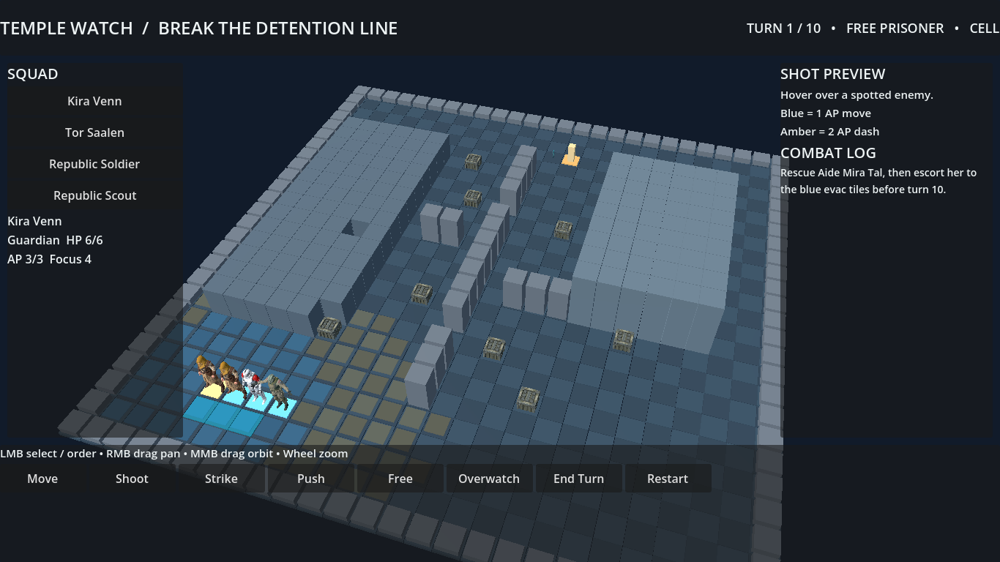

# Temple Watch desktop rescue mission

Godot 4.7.2, milestones 1–3 complete with parts of milestone 4. Open a desktop window from the repository root:

```bash
./godot/run.sh
```

`run.sh` uses `GODOT_BIN` when set; otherwise it uses the installed Godot binary at `/home/jess/projects/.tools/godot/godot`. To use a different Godot installation, set `GODOT_BIN` to its executable path. The game itself uses only `res://` paths and works with a Windows Godot build after opening/importing the project.

## Play

- Click a squad member or their name to select them. Choose **Move**, then click a blue tile for a 1 AP move or amber tile for a 2 AP dash.
- Choose **Shoot**, **Strike**, or **Push**, then click a spotted enemy. Hover over an enemy to see hit, crit, graze, line of sight, and the aim breakdown. Strike and Push belong to the Jedi. Push costs 1 AP and 2 Focus; it can break cover on collision.
- When next to the prisoner, choose **Free** and click her marker. Escort her back to the blue evac tiles. She follows her rescuer and advances toward evac while the escort stays close. A nearby squadmate can take over if the escort falls.
- **Overwatch** spends the selected unit's remaining AP and fires at the first enemy that moves into sight. **End Turn** runs the enemy turn. Reach evac before the end of turn 10. **Restart** starts a fresh mission.
- Middle mouse drag orbits, right mouse drag pans, and the wheel zooms. Enter ends the turn; R restarts.

## What is implemented

The 26×26 mission has two routes around a central barricade, low and high ground, directional half/full cover, corner peeks, three staged enemy groups, a prisoner beyond first contact, an announced east-side reinforcement, a clock, and win/lose screens. Squad stats and class names, enemy stats, AP costs, Force Push, saber strike, cover values, range and height aim modifiers, flank crit, and graze were ported from the web game. The web game stays untouched. Mission, units, and ability costs are in `godot/data/*.json`. `godot/scripts/shot.gd` is the single calculation path for previews, execution, reaction fire, and AI.

The first desktop mission has simplified enemy tactics, square-by-square movement, no animation/cinematic camera, no campaign layer, no audio, and no Windows export preset yet. Armor pips, destructible cover through Push, and overwatch cover part of milestone 4. The Godot build does not yet port every web class skill or weapon kit.

## Test

```bash
./godot/test.sh
```

Actual run on Godot 4.7.2: **60 checks, 0 failures**. This includes **12 aim cases** generated directly from frozen `public/js/rules.js` using `node godot/tests/generate_aim_cases.cjs`, directional cover and line-of-sight cases, move/shoot AP, clock loss, evac win, two map routes, reinforcement timing, Force Push cover damage, and **20 seeded bot rescue missions** with **0 script errors**. The bot won **8/20 (40%)**. The bot is a simple greedy rescuer; this rate is a reproducible test result, not a balance target.

## Screenshot



Captured under `xvfb-run` with the Godot viewport capture hook:

```bash
xvfb-run -a -s '-screen 0 1366x768x24' ./godot/run.sh -- --capture="$PWD/docs/godot/shots/rescue-mission.png"
```
