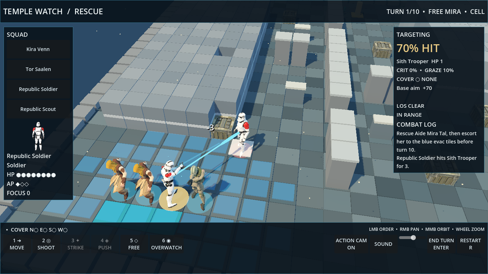
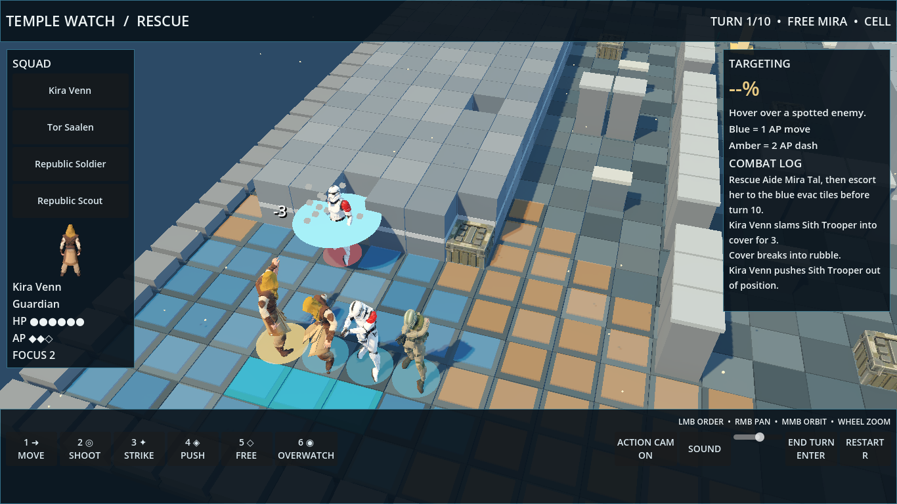

# Temple Watch desktop rescue mission

Open with Godot 4.7.2 from the repository root:

```bash
./godot/run.sh
```

`GODOT_BIN` can point to another Godot 4.7 build. The project uses `res://` assets and can be opened on Windows. Forward+ rendering enables SSAO and glow. The web game in `public/` remains untouched.

## Play

- Click a squad member or their name to select them. Press **1–6** or use the bottom bar for **Move**, **Shoot**, **Strike**, **Push**, **Free**, and **Overwatch**. Click a reachable tile or target to act. A blue path costs 1 AP; an amber dash costs 2 AP.
- Hover a tile to see the route, AP cost, and cover from its north, east, south, and west sides. Hover a spotted enemy for hit, crit, graze, cover, line of sight, range, and the aim breakdown.
- Rescue Aide Mira Tal with **Free** while adjacent, then escort her to the cyan evacuation tiles by turn 10. **Enter** ends the turn; **R** restarts.
- Right mouse drag pans, middle mouse drag orbits, and the wheel zooms. Click or press **Space** to skip an action camera. The bottom bar has an action camera toggle, sound mute, and volume slider.

## Presentation

Rigged GLB models now keep their view nodes between state updates and play idle, run, shoot, swing, cast, hit, and death clips. Player movement follows the calculated tile route at about four tiles per second; the rules still resolve immediately so headless bot turns remain fast. Attackers turn toward their target. Enemy moves animate and the camera follows their turn. Revealed enemies receive an alert callout.

Shots have side colored bolts, a tracer, muzzle sparks, impact debris, miss fly past, and floating damage, MISS, GRAZE, CRIT, and armor text. Saber strikes have a glowing trail. Force Push has a shockwave, target slide, and cover chunks. The camera glides to selected units and blends to a skippable shoulder view for actions over 0.6 seconds. Critical hits and deaths add a small shake.

Forward+ lighting adds a warm key, cool fill, shadows, ambient occlusion, fog, and glow. The board has varied floor colors, high ground lips, rubble, modeled crates and terminals, barricades, and dust motes. The HUD adds a model portrait, HP and AP pips, the turn clock, objective, ability hotkeys, path preview, directional cover cues, enemy activity banner, and outcome screen. Sound effects are synthesized locally in GDScript as PCM streams; no external audio is used.

Mission rules and aim calculations remain in `godot/scripts/mission.gd` and `shot.gd`. Presentation lives in `game.gd`, `unit_view.gd`, `fx.gd`, and `audio.gd`. The map and units are defined in `godot/data/*.json`.

## Verification

```bash
./godot/test.sh
```

Actual Godot 4.7.2 run: **65 checks, 0 failures, 0 script errors**. The checks include 12 aim fixtures generated from frozen web rules, mission geometry and abilities, 20 seeded rescue bot missions, and a headless scene test that loads the presentation, moves, shoots, and advances three enemy turns. The bot won **8/20 (40%)**; that is a regression result, not a balance target. Screenshots were rendered by software Vulkan under `xvfb-run`; RTX frame rate was not measured in this environment.

## Screenshots






Capture the same frames from the repository root:

```bash
xvfb-run -a -s '-screen 0 1366x768x24' ./godot/run.sh -- --capture="$PWD/docs/godot/shots/rescue-mission.png"
xvfb-run -a -s '-screen 0 1366x768x24' ./godot/run.sh -- --demo=shot --capture="$PWD/docs/godot/shots/rescue-shot.png"
xvfb-run -a -s '-screen 0 1366x768x24' ./godot/run.sh -- --demo=push --capture="$PWD/docs/godot/shots/rescue-push.png"
```
