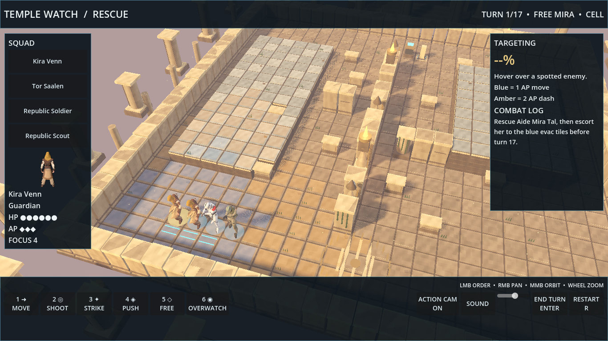
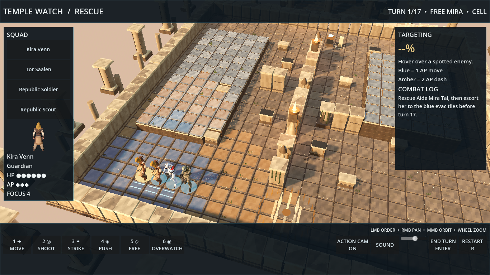
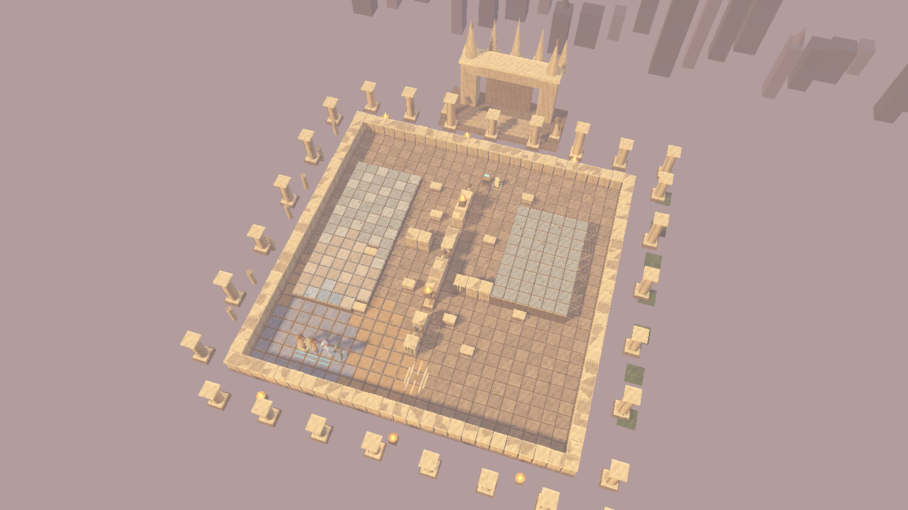
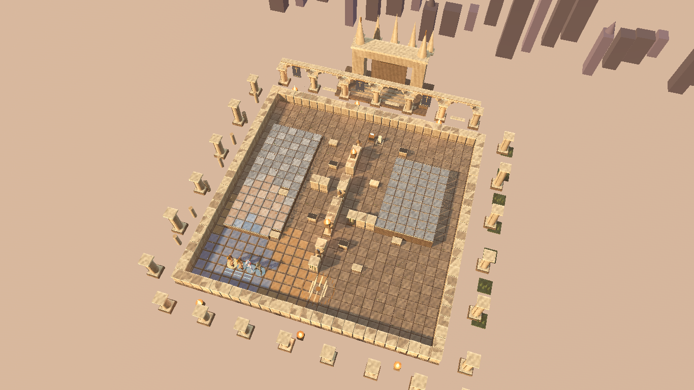

# Wave 4 art report

### Player view

The temple now has a north arcade with open arches, sunlit windows, blue and gold banners, and a stronger visual path to the gate. Elevated terraces have pale marble, bronze or dark inlay, and carved risers that separate them from the lower courtyard. Stone has procedural color, normal, roughness, and edge variation. Reinforced half cover has a dark metal cap, while full cover remains tall stone. The scene uses warm directional light, cool fill, soft volumetric fog, ACES tonemapping, restrained glow, and contact shading. All added architecture stays outside the playable grid; cover heights and tile highlights remain legible from the default camera.

To see it in game, start the rescue mission from the menu. The default camera shows the terraces, cover, and inlay; zoom toward the north gate to see the arcade and banners.

### Same-camera captures

Both pairs were captured at 1366 × 768 with the same mission seed and camera coordinates. The default pair includes the HUD and units. The overview pair shows the entire board.

| Camera | Before | After |
| --- | --- | --- |
| Default |  |  |
| Overview |  |  |

### Verification and timing

`./godot/test.sh`: **140 checks, 0 failures**; Normal rescue bot 11/20 wins (55%). No rule code changed.

The `env_capture.gd` benchmark warms up for 60 frames and measures 180 presented frames at 1366 × 768, Forward+ Vulkan on the NVIDIA GeForce RTX 4090 Laptop GPU. Under Xvfb, the overview camera measured **29.25 ms mean / 25.83 ms median / 50.00 ms p95 before**, and **28.30 ms mean / 25.94 ms median / 46.08 ms p95 after**. Xvfb reports no DRI3 presentation support and runs at roughly 34–35 fps. A direct Wayland run of the final scene measured **7.01 ms mean / 6.12 ms median / 10.94 ms p95**, or 142.7 fps mean. A repeat direct run measured 3.53 ms mean / 4.34 ms p95. Both direct runs meet the 60 fps frame budget of 16.67 ms.

### Integration requests

- Complete: the Wave 4 report and four captures now live at the required paths. Terrain rebuild uses live mission glyphs.

### Open problems

- Xvfb screenshots and benchmarks run much slower than the direct Wayland display because Xvfb lacks DRI3 presentation support. Use the direct display benchmark to judge the 60 fps target on this machine.
- Volumetric shafts are subtle from the default camera because the arcade is behind the mission grid. A brighter shaft setting reduced tile contrast, so the current setting favors tactics readability.
