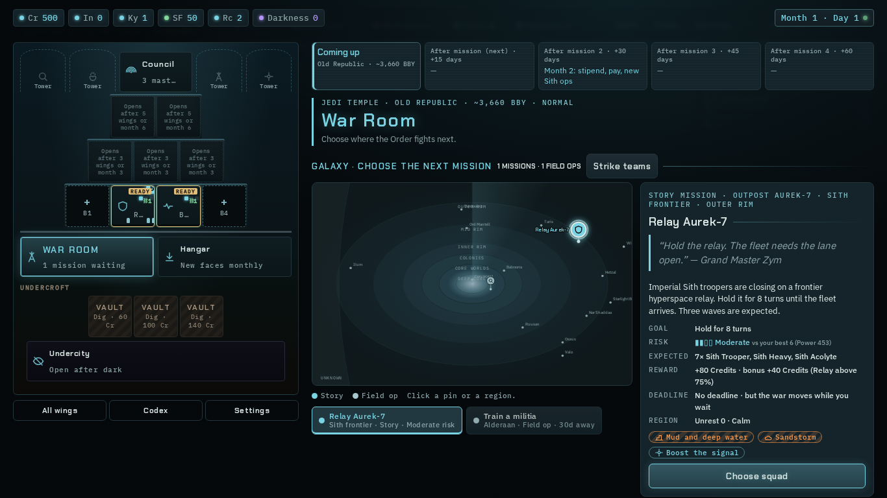
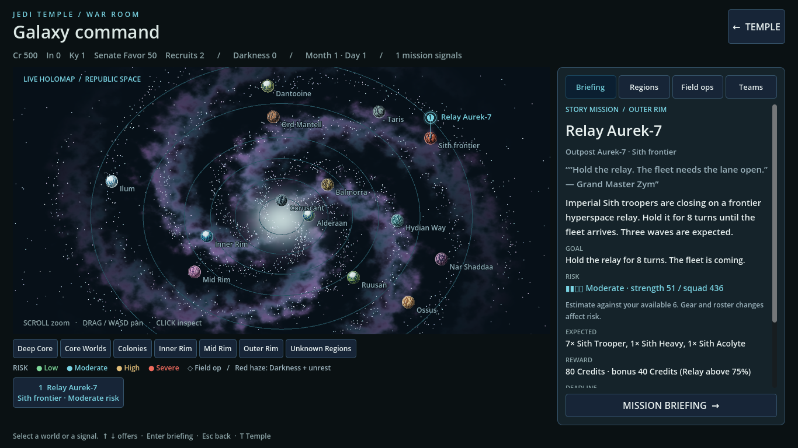
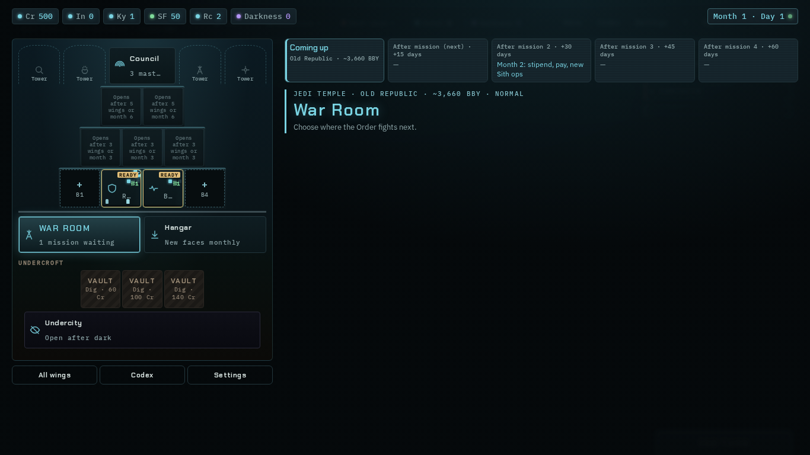
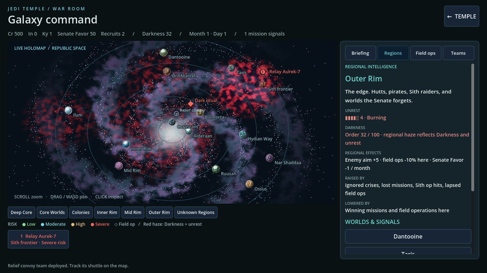
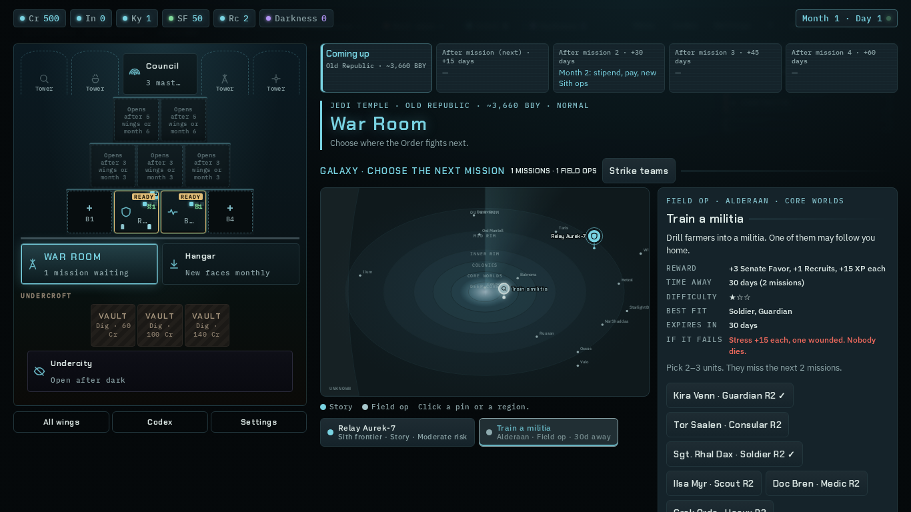
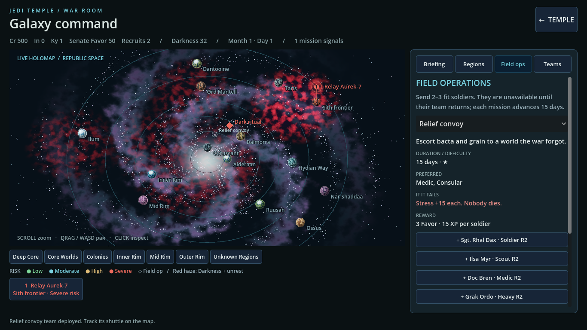
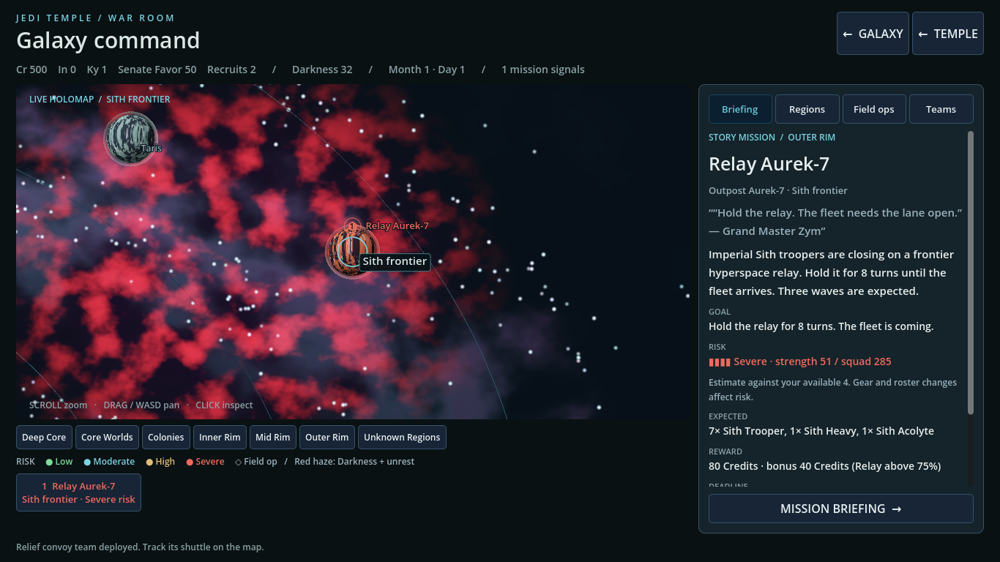

# Wave 6 — Galaxy with depth

Branch: `wave6/galaxy`. All authored changes are inside the galaxy lease. No shared theme, campaign state/flow, web source, or test-runner edits.

## Player-visible changes

- A live 3D map replaces the flat dots: four spiral arms, layered nebula, 3,400 twinkling stars, seven regional rings/areas, and all **14** entries in `galaxy.json.PLANETS`, including the abstract Inner Rim, Mid Rim and Hydian Way entries.
- Each world has its own biome palette and seeded procedural surface, an atmosphere, slow rotation and small orbital drift. The map includes city worlds, temperate oceans, ice, desert, volcanic terrain, grasslands and a gas giant.
- Mission offers pulse in their current risk color. Multiple offers sharing one planet fan out into separate clickable markers; the offer index and mission ID are never remapped. Deployed field teams fly the web game's existing shuttle model along deterministic routes. Clicking a shuttle opens Field ops. Existing Sith operations, when supplied in campaign state, appear as red diamonds and open their region intelligence.
- Clicking a planet or offer flies the camera there and slides the relevant briefing/region panel into view. **Galaxy / Esc** returns to the previous map position and zoom; **Temple / T** returns to the Temple. Mouse wheel zoom, mouse drag and WASD (while over the map) pan smoothly. Hovering a world brightens its atmosphere and shows a nameplate; buttons have quiet hover audio.
- The briefing keeps quote, location/region, story or mission kind, description, goal/par, risk band, enemy strength/squad estimate, expected enemies, concealment, rewards/bonus, reward secrecy, deadline, unrest, ignored consequences, requester, personal/redemption quest requirements, and available roster. The briefing button stays visible while the details scroll. Threat-clock missions explain the reinforcement pressure and failure threshold.
- Regions expose their descriptions, worlds and signals, unrest level/word, Darkness and regional-pressure information. The resource/calendar strip includes Credits, Intel, Kyber, Senate Favor, Recruits, Darkness, month/day and mission count.
- Field ops exposes **all 14 definitions**, not the previous three buttons: description, duration, difficulty, preferred classes, scaled rewards, fee, actual current failure consequence, 2–3 soldier selection, odds, teams in flight, return times and the field log. Existing dispatch, soldier assignment, saving, and crisis strike-team assignment use the original campaign methods.
- Risk uses the web bands (`0 / 9 / 13.5 / 18`) and enemy/tuning tables. Squad Power is explicitly an estimate using available Godot roster/gear stats; it is not presented as an exact clone of every web-only skill modifier.

## Reference and window captures

Built with `node tools/inline.js`. Playwright loaded the built game at **1366×768** and opened the actual War Room and its region/field panels. Colors follow the web's dark teal, cyan, amber, green and red tokens; the shared Godot theme remains untouched.

These Godot images come from the real windowed scene on the NVIDIA Vulkan renderer, not a headless placeholder. The Darkness/field/briefing captures deliberately use a test fixture with Order Darkness 32, Outer Rim unrest 4, a deployed relief team and a pending Sith ritual; the clean overview uses a new campaign. No player save was changed.

| Web reference | Godot 1366×768 |
| --- | --- |
|  |  |
|  |  |
|  |  |

Focused planet / briefing: 

1920×1080: [overview](../shots/wave6-galaxy-overview-1920.png), [Darkness](../shots/wave6-galaxy-darkness-1920.png), [field ops](../shots/wave6-galaxy-field-ops-1920.png), [briefing](../shots/wave6-galaxy-briefing-1920.png).

## Validation

- `./godot/test.sh`: 367 combat checks, 45 campaign checks, 225 story checks, 179 loop checks — **816 checks, zero failures**, no `SCRIPT ERROR`. The loop reaches the real mission briefing, squad selection and battle, then wins the campaign fixture.
- `/home/jess/projects/.tools/godot/godot --headless --path godot -s tests/galaxy_view_test.gd`: **62 checks, zero failures**. Covers every planet surface/atmosphere, every region and tab, overview visibility of every world, orbital motion, camera return, field assignment and a shuttle, Sith marker inspection, co-located offers, actual GUI marker input, settled panel placement, unchanged IDs/indexes for two different mission offers, and an empty campaign.
- Windowed runs use the same test with `-- --capture` and `-- --capture --large`: **66 checks** including four screenshot writes per run. Native Wayland explicitly sizes the window to 1366×768 or 1920×1080.
- Native Wayland / NVIDIA RTX 4090 Laptop GPU / Forward+: a 180-frame sample at **1920×1080** measured **9.54 ms median / 13.42 ms p95** (both under the 16.67 ms budget). A final capture taken concurrently with the full combat regression measured 13.03 ms median / 22.53 ms p95, so contention can exceed the frame budget. These are short scene samples, not a guarantee under arbitrary system load. An Xvfb capture was also tested but its software presentation was much slower; that is not the native performance measurement.
- All authored GDScript files are below 600 lines. `git diff --check` is clean.

Reproduce the final window captures:

```sh
/home/jess/projects/.tools/godot/godot --display-driver wayland --path godot \
  -s tests/galaxy_view_test.gd -- --capture
/home/jess/projects/.tools/godot/godot --display-driver wayland --path godot \
  -s tests/galaxy_view_test.gd -- --capture --large
```

Asset provenance/conversion: [galaxy CREDITS](../../../godot/assets/galaxy/CREDITS.md). The reused shuttle was decoded/dequantized to standard glTF because Godot cannot directly import the frozen web model's meshopt extension. Procedural surfaces and effects need no external textures.

## Integration requests / existing campaign limitations

The presentation preserves the existing Godot campaign semantics. Full web simulation parity still requires changes outside this lease:

1. **Campaign owner:** `state.gd` currently offers direct field dispatch rather than the web's timed, planetary offer generation/expiry. It resolves failed field missions with stress, without the web's wound/covert-capture rules. The panel accurately describes the existing result and exposes all available definitions. Add those campaign rules and persisted destinations/deadlines before claiming complete web field-op parity.
2. **Campaign owner:** Regional unrest values exist, but the web's region-based enemy aim, field odds, monthly Favor pressure, and field-win/lapse hooks are not all applied by the current campaign/battle bridge. Regional intelligence retains the web rule information; haze reflects actual saved unrest and Darkness. The view does not silently retune battles.
3. **Campaign owner:** The current Godot campaign does not generate/resolve the web's `ops.list` Sith operations or implement their Intel/team counter APIs. This lane renders their available information (marker, region, description, deadline, counter cost and team) when present in state. Generation, counter buttons and resolution need the campaign owner. The existing crisis/strike-team assignment flow remains functional; the separate web two-front campaign mechanic is likewise outside this view's state API.
4. **Test-runner owner:** Add `galaxy_view_test` to `godot/test.sh`'s suite list. The runner is outside this lease, so the test is delivered and run separately here.
5. **Screens owner:** Shared fonts can later supply the web's Chakra Petch / IBM Plex typography through `ui.gd`; this lane uses the existing theme's font while matching the web's colors and information hierarchy locally.

No push. Local commit only.
