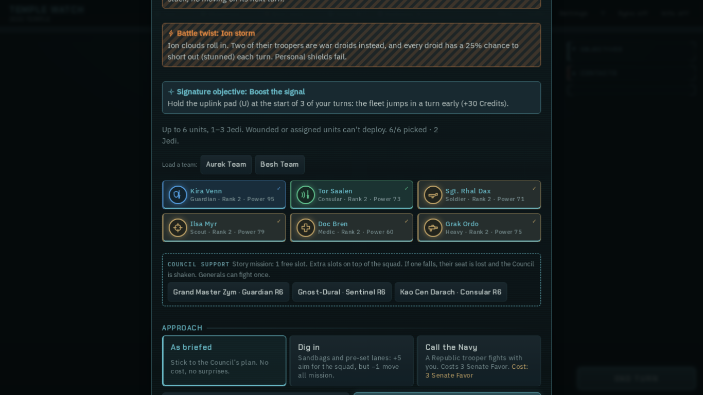
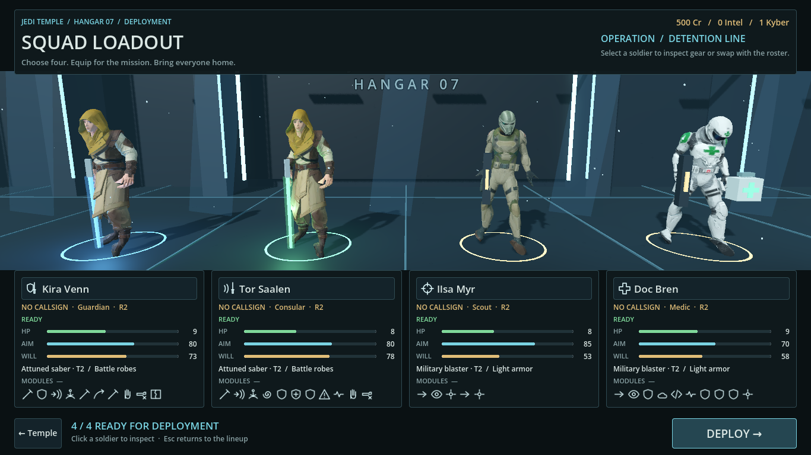
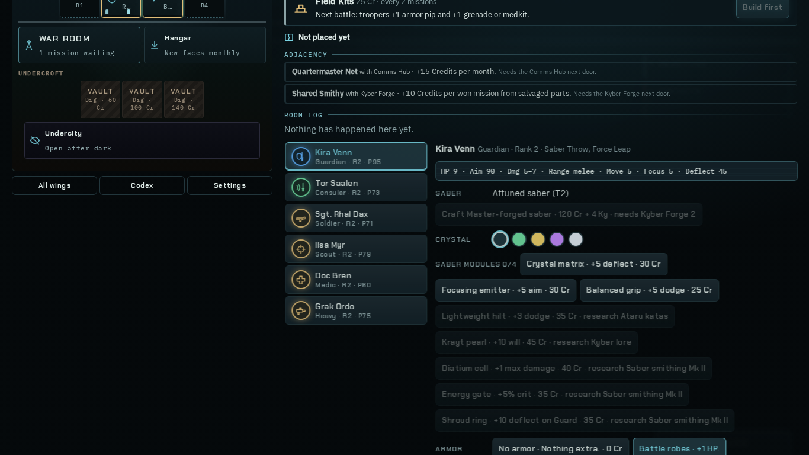
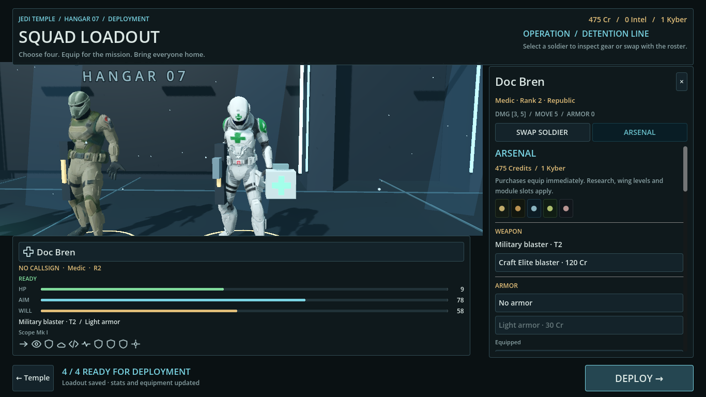

# Wave 6 — Loadout

Branch: `wave6/loadout`. All changes are in the loadout lease. Web, campaign state, gear, battle bridge and shared theme remain read-only.

## Player-visible changes

- Replaced the deployment list with four animated, textured soldiers in a lit Temple hangar. Jedi carry glowing sabers in their saved crystal colors; troops carry blasters; the Medic has a visible medical case. Armor tint, weapon tier, scopes and saber color update after purchases.
- Cards show name, saved nickname (or **No callsign** when none exists), web class icon, rank, readiness, HP/aim/will bars, equipped weapon/armor tier, installed module Mk levels, utility equipment and skill icons with ability-name tooltips.
- Clicking a model or its name focuses the camera and opens a roster/Arsenal drawer. The roster has rendered portraits for every soldier, selection markers and disabled unavailable rows. Wounds show actual recovery days, including accelerated rest; field assignments show remaining days. Indefinite training/staff assignments say **until released**, rather than inventing a deadline.
- Arsenal offers weapon/saber upgrades, armor, utility, forms, crystal/troop colors, module fitting/removal/Mk upgrades and evolution. It displays wing/research/slot/resource locks, uses the existing `Gear` methods to transact, saves immediately and refreshes models and stats. Module removal follows web behavior: no refund.
- Idle animation, subtle breathing/sway, drifting dust, light shafts, camera drift, saber light modulation and synthesized hum, hover rings/sounds and drawer/tab fades remain active. Portraits render once into small independent viewports.
- The Temple return and deploy actions stay in the footer. Four fit, distinct soldiers are required. Legacy `_toggle()` / `_deploy()` remain available; roster replacement persists into the campaign save and actual battle squad.

## References and real-window captures

Built the frozen web reference with `node tools/inline.js`; captured it using Playwright/Chromium at 1366×768. Godot images come from the real `squad.tscn` in a Wayland window using Forward+, not a dummy headless renderer. The capture fixture swaps the Soldier for the Medic; the unavailable image additionally gives the bench Soldier a wound and the Heavy a training assignment.

| Frozen web reference | Godot implementation |
| --- | --- |
|  |  |
|  |  |

Additional captures: [roster drawer](../shots/wave6-loadout-roster.png), [Jedi inspection](../shots/wave6-loadout-jedi.png), [unavailable soldiers](../shots/wave6-loadout-unavailable.png), [1920×1080 lineup](../shots/wave6-loadout-lineup-1920.png), [1920×1080 roster](../shots/wave6-loadout-roster-1920.png), [1920×1080 Arsenal](../shots/wave6-loadout-arsenal-1920.png). [Mission portion of the web reference](ref-loadout-squad.png).

## Validation

- `./godot/test.sh`: exit 0, **816 checks / 0 failures**: tactical 367, campaign 45, story 225, loop 179. No `SCRIPT ERROR`, `Parse Error` or `ERROR:`. The loop's campaign bot won.
- `godot --headless --path godot -s tests/loadout_test.gd`: **75 checks / 0 failures**. Covers every roster portrait/model/card, model fallback for every campaign class, real viewport mouse input, focus/close, unavailable rows and recovery/assignment days, duplicate rejection, roster persistence, gear/module/research/wing/price checks, saber crafting/color, live model equipment and stats, save/load, actual launch and battle roster/Medic kit/armor.
- Real-window captures at 1366×768 and 1920×1080. Warm 1920×1080 runs reported 73 and 141 FPS on the available RTX 4090 Laptop GPU; 1366×768 reported 84 FPS. These are short `Engine.get_frames_per_second()` samples, not a long-duration benchmark. Xvfb presentation was much slower and is not used for the performance result.
- All new GDScript files are below 600 lines. `git diff --check` passes.

Reproduce captures with `/home/jess/projects/.tools/godot/godot --display-driver wayland --path godot -s scripts/campaign/loadout_capture.gd` (add `-- wide` for 1920×1080). The harness uses a disposable save and removes it afterward.

## Integration requests

1. **Shared gear/stat parity:** `gear.gd::battle_stats()` does not yet apply web `CRYSTAL_FX`, `SABER_TRAITS`, or Arsenal research bonuses (`livingForce`, `repeaters`, `ordnance`, `namelessLore`). Crystal selection currently changes the model and saved color; the displayed stats deliberately match the actual Godot battle calculation. Please implement these effects centrally before presenting them as tactical bonuses. A saber-trait setter is also needed; this screen does not offer an ineffective trait purchase.
2. **Shared class kits:** `battle_bridge.gd` falls back to Guardian/Soldier kits for campaign classes without a player entry in `data/units.json`, including Heavy. This screen shows the kit actually deployed, rather than claiming unsupported web abilities. Please port the missing class/promotion kits in the battle layer; the loadout display derives its icons from that same catalog automatically.
3. **Test runner:** add `loadout_test` to `godot/test.sh` during integration. It is run separately here because the runner is outside this lane's lease.

The web reference permits a different squad size and places mission approach choices on the squad modal. This lane preserves the requested four-person Godot flow and its existing briefing approach choices.

## Assets

Existing project models only; no new downloads or generated images. Five ~10k-triangle models are copied/decoded under `godot/assets/loadout/models/`. Web stroke icons are copied to SVG. Attribution and conversion details are in [CREDITS.md](../../../godot/assets/loadout/CREDITS.md).
