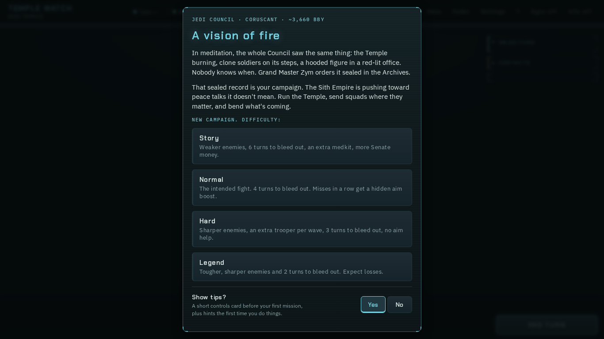
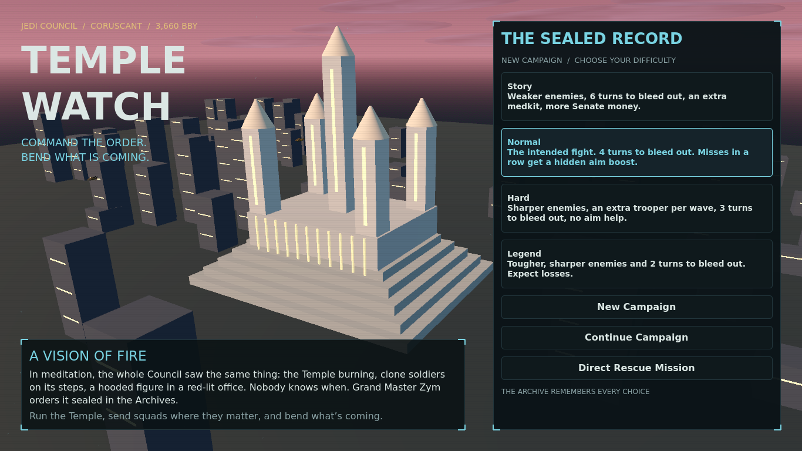
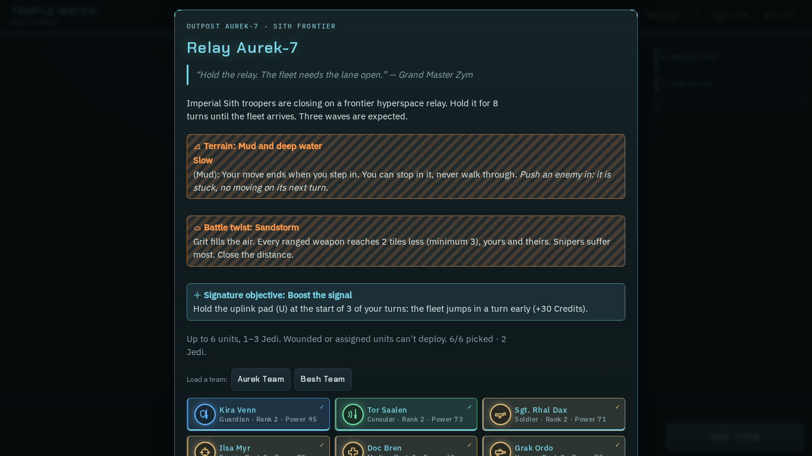
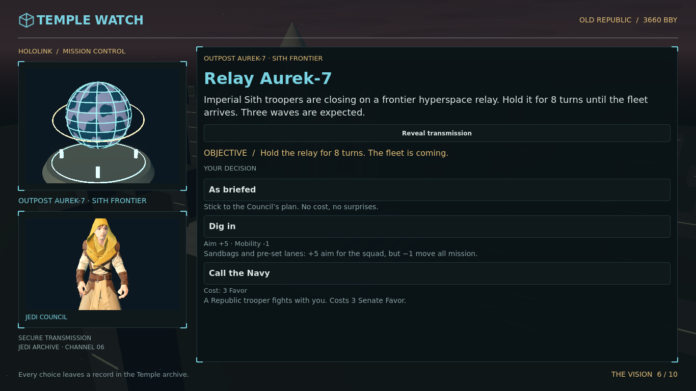
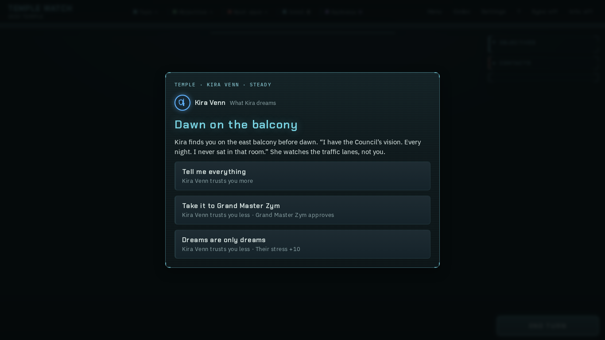
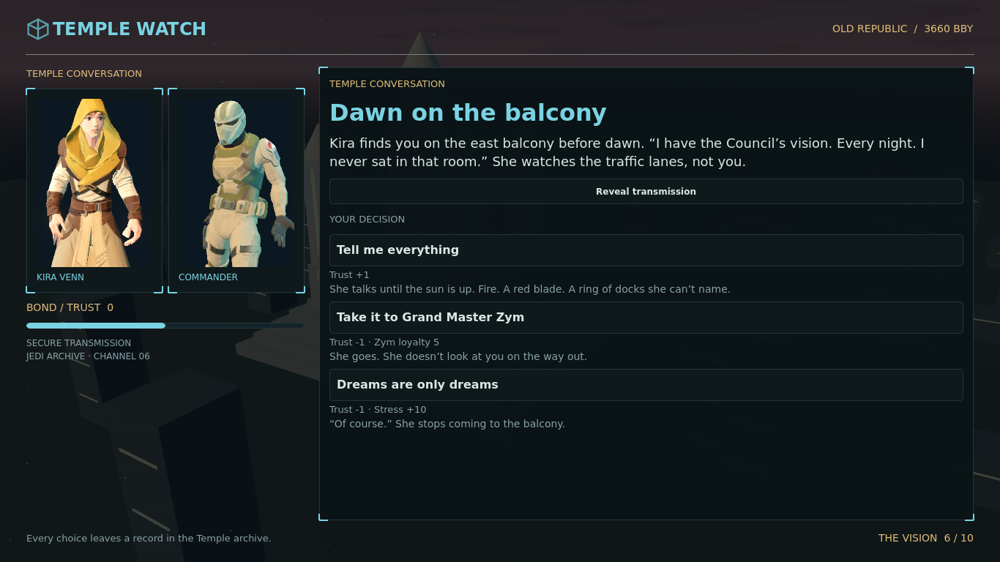
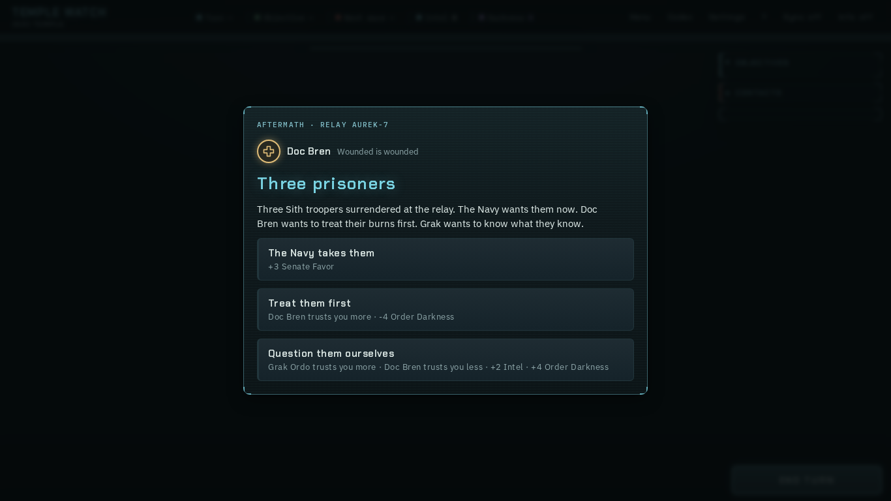
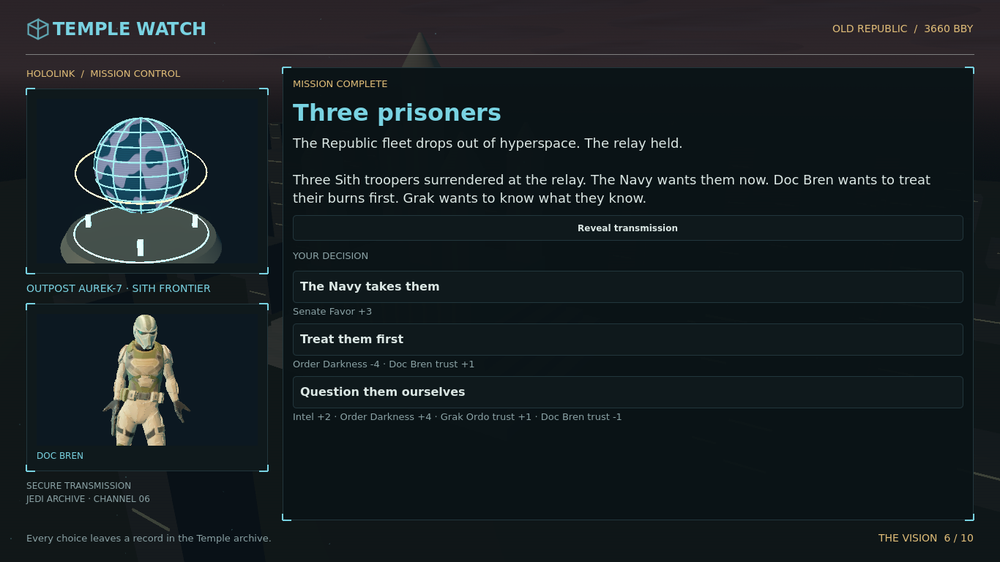
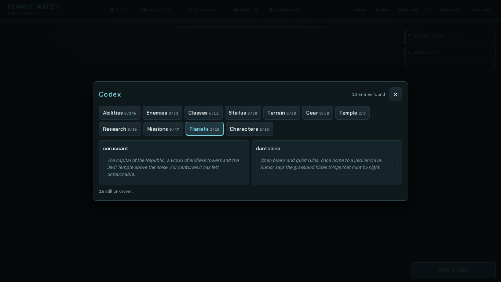
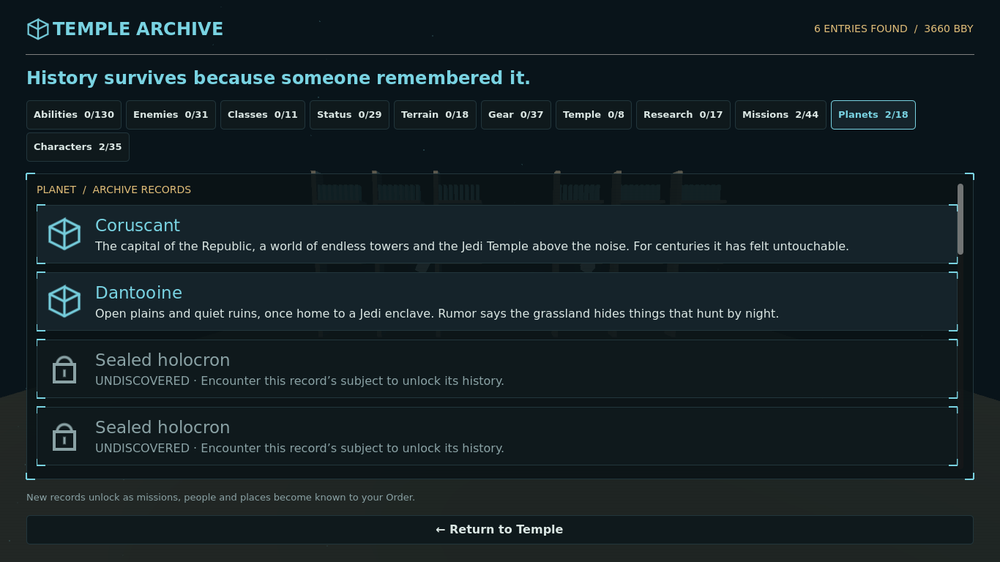

# Wave 6 — shared look and living screens

Branch: `wave6/screens`. All implementation changes stay inside the screens lease. Web sources are unchanged.

## Player-visible changes

- Shared `campaign/ui.gd` preserves `panel`, `label`, `button`, `column`, `clear`, `style_button`, their defaults, and the existing color constants. It now uses the web's exact teal/cyan/gold palette, archive corner trim, hover/focus glow, quiet synthesized feedback, and panel entrance transitions. Existing lane callers inherit this styling. Added `font`, `style`, `icon`, and `slide` helpers are optional.
- Menu: a real 3D five-spire Temple above the city at dusk, drifting cloud banks, moving air taxis, slow camera movement, ambient dust, the opening vision, full web difficulty explanations, and all three existing start/resume paths.
- Briefing/debrief: a rotating, location-seeded planet projection with terrain, latitude/longitude lines, orbital ring and projector; framed animated unit portraits; typed text with an immediate reveal button; objective and consequence/cost previews; framed choices. Long transmissions and choices remain scrollable.
- Temple talks: two inward-facing animated unit portraits, a trust meter using the engine's actual −3…3 range, and an animated change before a player-activated choice completes. Programmatic `_choose(id)` retains its immediate completion contract. Duplicate activation cannot apply a choice twice.
- Codex: animated archive shelving and floating holocrons behind the UI; all eleven categories with discovery counts; unlocked records first, followed by sealed holocrons that conceal names/lore. All lore remains available. The return button remains visible even in a fresh campaign with every record locked.

## Reference and rendered comparisons

References were built with `node tools/inline.js` and captured with Playwright at 1366×768. The web puts briefing/approach inside squad selection, and aftermath in its Saga scene. Godot images below come from actual windowed scenes, using Vulkan Forward+ and the native Wayland display driver.

| Screen | Web reference | Godot scene |
| --- | --- | --- |
| Menu |  |  |
| Briefing/approach |  |  |
| Temple talk |  |  |
| Debrief/aftermath |  |  |
| Codex |  |  |

1080p captures: [menu](../shots/wave6-screens-menu-1920.png), [briefing](../shots/wave6-screens-briefing-1920.png), [dialogue](../shots/wave6-screens-dialogue-1920.png), [debrief](../shots/wave6-screens-debrief-1920.png), [Codex](../shots/wave6-screens-codex-1920.png).

## Validation

- `./godot/test.sh`: exit 0, no SCRIPT ERROR or ERROR. Core **367**, campaign **45**, story **225**, and campaign loop **179** checks; **816 total, 0 failures**.
- `godot --headless --path godot -s tests/screens_test.gd`: 38 checks, 0 failures. Covers all scenes, difficulty selection, typed-text reveal, portraits, trust animation and effects, rejected unaffordable choices, duplicate-choice protection, debrief choices, every Codex category, locked records, the campaign return path, and footer bounds.
- `tests/loop_test.gd` separately: 179 checks, 0 failures, campaign bot win.
- All GDScript files are below 600 lines; `git diff --check` is clean.
- Reproduce captures: `godot --display-driver wayland --path godot -s scripts/ui_capture.gd -- dialogue --large`. Omit `--large` for 1366×768; scene choices are menu, briefing, dialogue, debrief, codex. Capture helper waits for warmup, measures 120 frames, and saves the real viewport.

Performance: repeated city/shelf geometry is batched with MultiMesh. At native 1920×1080, the final full-resolution dialogue capture measured **85 fps** on the NVIDIA RTX 4090 Laptop GPU (Vulkan Forward+). The earlier half-resolution prototype measured 120 fps; the delivered stage uses full resolution. Xvfb's presentation path measured only 11–43 fps and is not representative of native presentation. Final 1080p captures measured: menu **113 fps**, briefing **162 fps**, dialogue **132 fps**, debrief **225 fps**, Codex **99 fps**. Earlier full-resolution dialogue measured **85 fps** while other work was running. These are 120-frame warm measurements, not a long-duration benchmark.

## Integration requests and limits

1. Add `screens_test` to the suite list in `godot/test.sh` when integrating. That file is outside this lane's lease; the suite was run explicitly here.
2. Fonts: `UI.font()` requests Chakra Petch, IBM Plex Sans and IBM Plex Mono, matching the web tokens. This machine lacks those families, so captures use DejaVu system fallbacks. Exact bundled fonts need an exception to Wave 6's CC0-only download rule: the web fonts use OFL. No font downloads or unapproved license additions were made.
3. Portraits reuse the existing animated Jedi/scout models as speaker archetypes, not bespoke likenesses. Named troop speakers use the scout model. Planet geography is procedural and deterministically keyed to the mission location, not canonical cartography. Credits are in `godot/assets/ui/CREDITS.md`.
4. No campaign rules, save format, story content, battle flow, or other lane files were changed. New UI helpers are independent of other lanes' work. Existing untracked UID files present at lane start are excluded from this commit.
