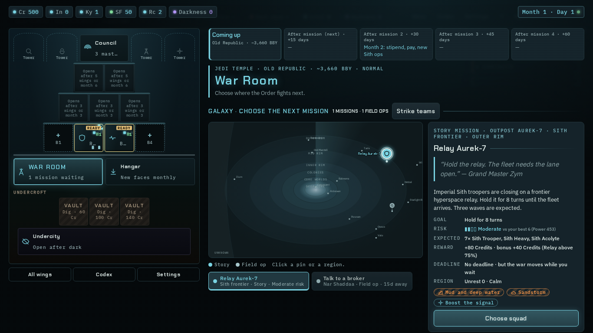
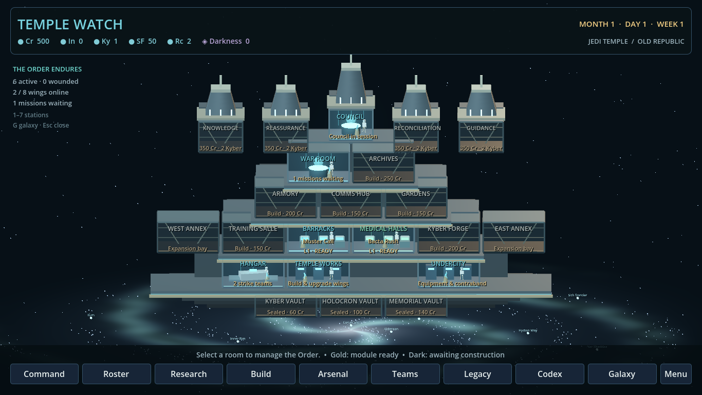
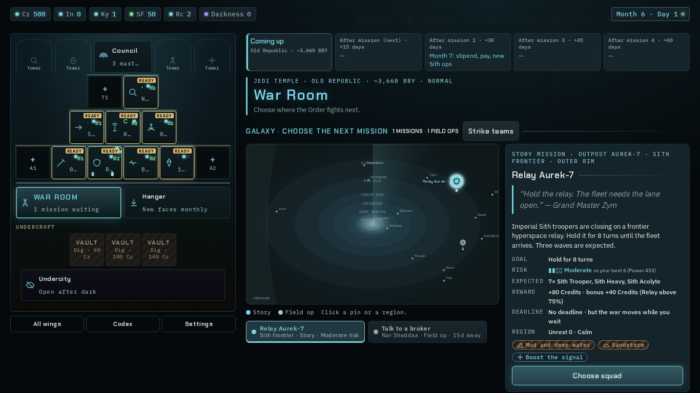
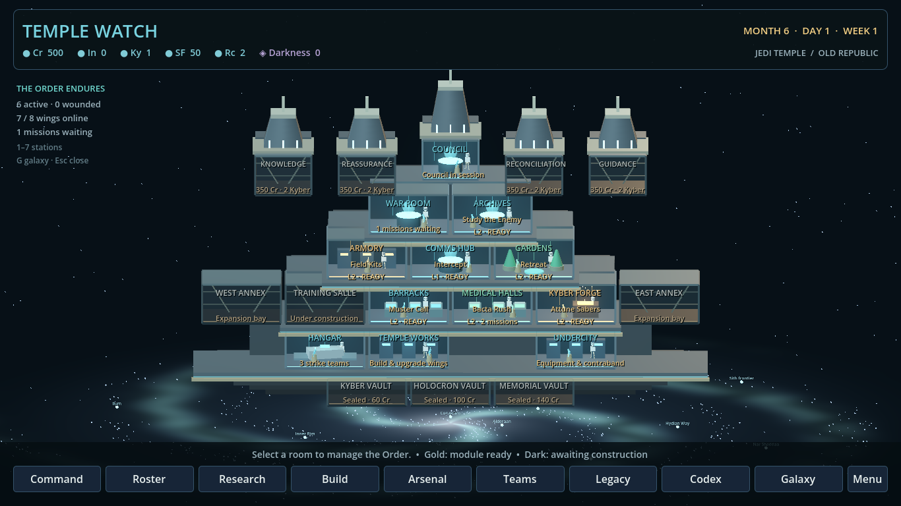
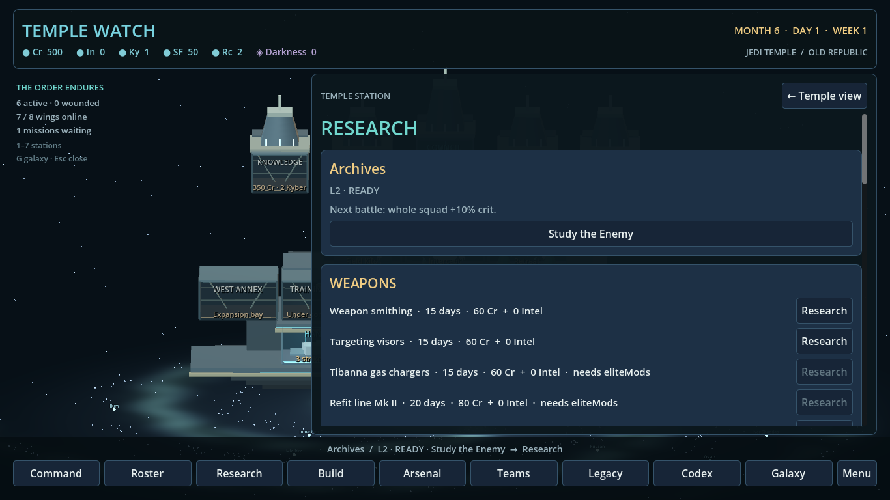
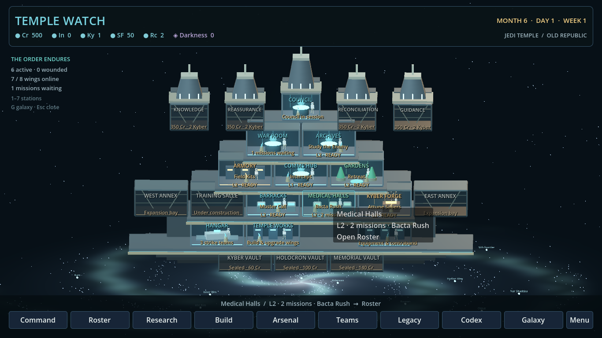

# Wave 6 — Temple with real shape

Branch: `wave6/temple`. Work is confined to the Temple lease. The frozen web files were read and built for reference; they were not edited.

## Player-visible changes

The Temple opens as a three-dimensional cutaway: four satellite towers and the taller Council spire above stepped terraces, base halls and suspended undercroft. A slowly rotating nebula and spiral star field sit below it. All 14 named planets in `godot/data/campaign/galaxy.json` have faintly glowing markers and labels.

There are 22 labeled, clickable cells: all 13 named rooms in `public/js/temple-map.js`, the four spires, three undercroft vaults and two annex bays from the web building data. The eight wing cells use the web's default terrace arrangement. Their illumination, scaffolding, level, construction status, first build cost, module name and cooldown come from the current campaign save. Unbuilt wings lead to Build. Built wings expose their existing module action in the station panel, using the existing affordability and cooldown rules.

| Cell | Existing destination |
| --- | --- |
| Council Chamber | Command |
| War Room | Galaxy |
| Archives | Research |
| Comms Hub | Galaxy |
| Training Salle, Gardens, Medical Halls, Barracks | Roster |
| Armory, Kyber Forge, Undercity | Arsenal |
| Hangar | Teams |
| Temple Works, annexes, sealed spires, Kyber Vault | Build |
| Holocron Vault | Codex |
| Memorial Vault | Legacy |

Command, Roster, Research, Build, Arsenal, Teams and Legacy retain their original controls in a panel that slides over the living scene. Galaxy and Codex retain their existing scene transitions and return paths. The bottom navigation also reaches every destination. Keys 1–7 and G are preserved; Esc closes the station panel.

Operational rooms contain animated CC0 `human.glb` figures with Jedi robes/sabers or clone armor silhouettes. Research and command rooms have floating holograms; the forge throws sparks. Ceiling lights pulse, patrols walk, the camera drifts, and room hover/focus highlights a cell, plays a quiet sound and names its status in the footer. Room props distinguish the infirmary, barracks, gardens, hangar, training room and equipment rooms. Static architecture is merged by material to reduce draw calls while animated objects remain independent.

The existing `CampaignFlow.temple_story` hook is unchanged. Council events, votes and Temple talks still interrupt arrival through the original story flow.

## Visual evidence

Reference: `node tools/inline.js`, then Playwright Chromium at 1366×768. The web's original Temple renderer was invoked after creating a campaign to photograph the hub without an opening story modal. The developed reference sets wings to level 1 and month 6. Godot captures use the actual `temple.tscn`, a windowed Forward+ renderer and isolated save fixtures; they are not headless dummy renders. The developed Godot fixture includes a wing under construction and an infirmary module on cooldown.

| Web reference, 1366×768 | Godot, 1366×768 |
| --- | --- |
|  |  |
|  |  |

| Sliding Research panel | Actual room hover |
| --- | --- |
|  |  |

1920×1080 captures: [arrival](../shots/wave6-temple-arrival-1920.png), [developed Temple](../shots/wave6-temple-built-1920.png), [research](../shots/wave6-temple-research-1920.png), [hover](../shots/wave6-temple-hover-1920.png).

## Validation

- `./godot/test.sh`: exit 0; 367 core, 45 campaign, 225 story and 179 loop checks, all with zero failures and no `SCRIPT ERROR`.
- `godot --headless --path godot -s tests/temple_view_test.gd`: 154 checks, zero failures. Covers scene loading, all cell identities and destinations, unobscured projected hit rectangles, an actual mouse click and hover, all planets, rotation, new and developed save round trips, construction, module cooldowns, inhabitants, forge sparks, all seven original stations, Codex and Galaxy navigation.
- Windowed runs add four image-save checks: 158 checks, zero failures at each resolution.
- Optimized native Wayland / Forward+ run on the RTX 4090 Laptop GPU: 76.8 average fps at 1920×1080 over 180 warmed frames. Static batching reduced the developed fixture from about 682 to 379 total draw calls. The 1366×768 native sample averaged 50.5 fps during concurrent machine activity. These short shared-machine samples vary; stable frame pacing still needs an isolated sustained measurement. Xvfb/X11 presentation was much slower and was not used for the final performance claim.
- The final optimized scene also passed the 179-check loop suite again. All Temple GDScript files are under 600 lines. `git diff --check` passes.

Reproduce captures (Godot binary: `/home/jess/projects/.tools/godot/godot`):

```sh
/home/jess/projects/.tools/godot/godot --display-driver wayland --path godot -s tests/temple_view_test.gd -- --capture-temple
/home/jess/projects/.tools/godot/godot --display-driver wayland --path godot -s tests/temple_view_test.gd -- --capture-temple --large
```

The test saves are process-specific and removed on success; captures do not alter the player's campaign.

## Integration requests

1. Add `temple_view_test` to the shared `godot/test.sh` suite list. That runner is outside this lease; the new suite was run separately here.
2. Godot's campaign state does not yet implement the web's tower construction, excavation, discoveries, adjacency bonuses or movable bays. These cells are represented and reachable, and optional existing web `mods.spire` / `mods.dug` flags are respected for appearance. Their costs are reference information, not newly enabled purchase actions. Shared campaign support is needed before these expansion projects can become playable. The eight existing wing construction and module actions remain functional.
3. If Galaxy and Codex must also be embedded overlays rather than their current full-scene routes, their owners should expose embeddable panel entry points. This lane preserves their existing lifecycle and return behavior.
4. Shared font/theme changes belong to the screens lane. Temple uses the existing `ui.gd` controls with local cyan/amber/green room accents and dark translucent framing; it does not edit the shared theme.

## Asset provenance

See [Temple asset credits](../../../godot/assets/temple/CREDITS.md). The CC0 web mannequin was decoded and dequantized to standard glTF with `@gltf-transform/cli` 4.5.1 because Godot cannot import its source meshopt/quantization extensions. Geometry, rig and animation clips are retained. Architecture, furnishings, nebula and effects are procedural; no new external artwork was downloaded.
